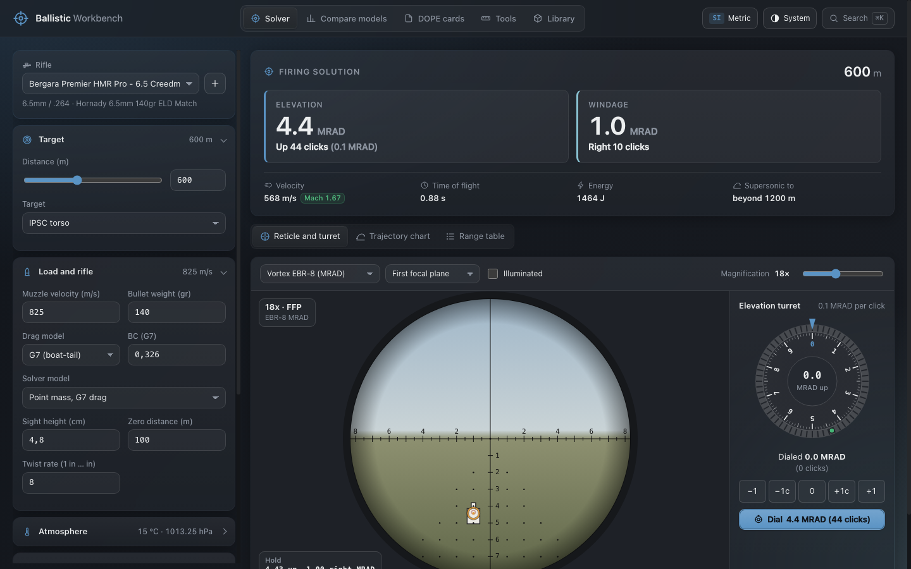
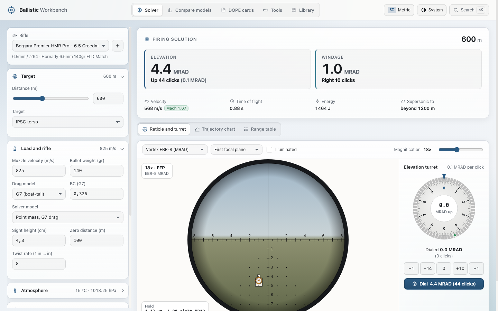
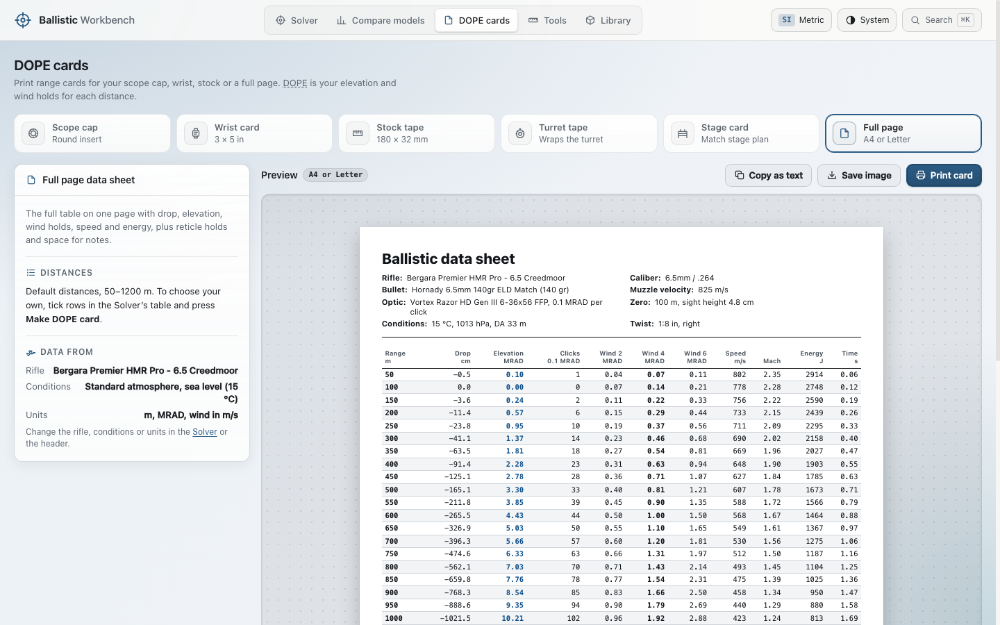

# Ballistic Workbench

An offline ballistics calculator for precision rifle shooters. Pick your rifle, set the distance
and conditions, and it tells you what to dial: elevation and windage in MRAD or MOA, with the
clicks for your scope. It also shows the hold in a simulated reticle, plots the trajectory, prints
range cards (DOPE cards) and has tools to true the model against your real impacts.

It's for long-range and PRS/NRL shooters, hunters and reloaders who want to plan and check firing
solutions on a laptop or phone, with or without a network on the range. Everything runs in the
browser; nothing is sent anywhere.

**Version:** 0.1.0

> Ballistic Workbench is a planning and learning tool. Always confirm firing solutions with live
> fire on a safe range before relying on them.

## What's new

### 0.1.0

The first version, with a complete redesign and a corrected ballistics engine:

- **Correct drag model.** Standard G1 and G7 drag tables (JBM), cross-checked against an independent
  solver within 0.01 MRAD and against Hornady's published 6.5 Creedmoor table. Corrected aerodynamic
  jump, spin drift, cant, Coriolis, stability and powder temperature; the zero no longer shifts with
  field conditions; 27 bullet BCs corrected to published values.
- **New interface** in the Låda Glass design, dark and light (follows your system), custom icons,
  plain-language text, and a phone layout.
- **Solver** shows one clear firing solution (elevation and windage with direction and clicks),
  with the reticle, trajectory chart and range table in tabs. Inputs are validated as you type.
- **DOPE cards** print at exact physical size; **Tools** each give a plain verdict; **Library**
  can edit, duplicate and delete rifles with undo.
- **Security:** strict Content-Security-Policy, imported and saved data is validated, no inline
  code, offline cache limited to the app's own files.

See [CHANGELOG.md](CHANGELOG.md) for the full list.

## Screenshots

<table>
  <tr>
    <td><br>Solver: the firing solution, with the reticle hold and elevation turret</td>
    <td><br>The same in the light theme</td>
  </tr>
  <tr>
    <td><br>DOPE cards: six printable formats with a true-size preview</td>
    <td><br>Tools: true your data, hit probability, group analysis, chronograph, range estimation, recoil</td>
  </tr>
  <tr>
    <td><br>Library: your rifles, 177 bullets and your own bullets</td>
    <td><br>Compare models: how G1, G7, MPM and 4DOF differ for your rifle</td>
  </tr>
  <tr>
    <td><br>Phone layout (390 px)</td>
    <td><br>Full-page data sheet in the light theme</td>
  </tr>
</table>

## Features

| View | What it does |
| --- | --- |
| **Solver** | The firing solution for the active rifle at the exact target distance: elevation and windage (MRAD or MOA, direction and clicks), velocity with Mach, time of flight, energy and how far the bullet stays supersonic. Tabs: a reticle view showing where to hold, with an elevation turret you can dial (mouse, touch or keyboard); a trajectory chart (drop, velocity, wind drift, time of flight, energy); a range table with CSV export, where you tick the distances for your DOPE card. |
| **Compare models** | How the point-mass G1 and G7, modified point mass (MPM: adds spin drift, aerodynamic jump and Coriolis) and 4DOF solutions differ for your rifle, as difference charts and a table. "Use in Solver" switches the model. |
| **DOPE cards** | Printable range cards at exact physical size: scope cap insert, 3 × 5 in wrist card, stock tape, turret tape, match stage card (with a stage builder and wind holds for lull, base and gust) and a full-page data sheet. Copy as text, save as image, or print. |
| **Tools** | **True your data** (muzzle velocity from a 500–800 m impact, then drag from a 1,000 m+ impact, applied to the rifle), **Hit probability** (simulates 500–2,000 shots from your error sources and shows what causes misses), **Group analysis** (from a photo or clicks: extreme spread, mean radius, dispersion ellipse and the correction to centre the group), **Chronograph** (SD, ES, mean; use the mean as muzzle velocity), **Range estimation** (from target size and reticle reading), **Recoil** (free recoil energy and velocity). |
| **Library** | Your rifles (use, edit, duplicate, delete with undo), 177 factory bullets with search and caliber filter (published BCs marked with their source, derived ones marked "estimated"), your own bullets with a live Miller stability check, and backup to / restore from a file. |

The command palette (**⌘K** on Mac, **Ctrl+K** elsewhere) reaches every view, tool and setting.

## Installation

There is no build step and the app has no runtime dependencies: it is plain HTML, CSS and
JavaScript modules served as static files.

```sh
git clone https://github.com/jozeta/Ballistic-Workbench.git
cd Ballistic-Workbench
python3 -m http.server 8080
```

Then open <http://localhost:8080>. The app must be served over HTTP: JavaScript modules and the
offline service worker don't load from `file://`.

**Install as an app:** in Chrome or Edge, use *Install app* in the address bar; on iPhone or iPad,
Safari's *Share → Add to Home Screen*. After the first visit the app works fully offline.

## Configuration

Settings are stored in your browser (`localStorage`); nothing leaves your device. Use
**Library → Export…** to keep a backup.

| Setting | Where | Options | Default |
| --- | --- | --- | --- |
| Units | Header button, palette | Metric (m, m/s, MRAD, cm) or imperial (yd, fps, MOA, in) | Metric |
| Theme | Header button, palette | System, light, dark | System |
| Rifle | Solver, Library, palette | Four example rifles (6.5 Creedmoor, .300 PRC, .308 Win, .223 Rem) or your own | 6.5 Creedmoor |
| Distance and target | Solver → Target | Distance; target IPSC torso, round plate, square plate or NATO E | 600 m, IPSC torso |
| Load and rifle | Solver → Load and rifle | Muzzle velocity, bullet weight, drag model (G1/G7), BC, solver model, sight height, zero distance, twist | From the rifle |
| Solver model | Solver → Load and rifle, Compare models, palette | Point mass G7, point mass G1, modified point mass, 4DOF | Point mass G7 |
| Atmosphere | Solver → Atmosphere | Presets (sea level, mountains 1,950 m, desert heat, winter) or your own temperature, station pressure, altitude and humidity; density altitude is shown | Standard atmosphere, sea level |
| Wind | Solver → Wind | Speed and the direction it comes from (drag the wind clock or type degrees; 90° = from the right) | 4 m/s from 3 o'clock |
| Shot angle and cant | Solver → Shot angle and cant | Inclination (+ uphill) and rifle cant (+ right) | 0° and 0° |
| Scope | Solver → Reticle tab, rifle dialog | Reticle, first or second focal plane, magnification, click value (0.1 / 0.05 MRAD, 1/4 / 1/8 MOA) | From the rifle |
| Range table | Solver → Range table | Row spacing 10 / 25 / 50 / 100 m; visible columns | 25 m, all columns |
| DOPE card | DOPE cards | Format, distances (defaults or the ones ticked in the Solver), card size and colour | Full page |

## How to

- **Get a firing solution:** choose your rifle at the top of the Solver, set the distance under
  **Target**, then check **Atmosphere** and **Wind**. The firing solution card shows what to dial.
- **Add your rifle:** press **+** next to the rifle in the Solver, or **Library → New rifle**. Pick a
  bullet from the list (or enter your own), then the muzzle velocity, zero, sight height and scope.
- **True the model to your rifle:** **Tools → True your data.** Shoot at 500–800 m, enter the
  elevation that centred your group and apply the muzzle velocity. Then do the same at 1,000 m or
  more to true the drag (it adjusts the BC).
- **Use your chronograph:** **Tools → Chronograph**, paste the velocities (spaces, commas or new lines
  between readings; 825,4 and 825.4 both work) and use the mean as the rifle's muzzle velocity.
- **Print a DOPE card:** in the Solver's **Range table**, tick the distances you want and press
  **Make DOPE card** (or go to **DOPE cards** directly for sensible defaults). Pick a format and press
  **Print card**. Check the 50 mm scale bar with a ruler: printers sometimes scale pages.
- **Plan a match stage:** **DOPE cards → Stage card**, choose a preset or add targets, set the lull,
  base and gust wind; the card shows the elevation and wind hold for every target.
- **Back up or move your data:** **Library → Export…** saves a file; **Import…** restores it on any
  device (files are checked before anything is replaced).

## Tests

```sh
npm install          # dev tools only (ESLint); the app itself needs nothing
npm test             # physics and reference checks, helpers, version, offline cache list
npm run test:browser # headless Chrome: every view in both themes and at phone width
npm run lint
```

`test:browser` needs Google Chrome (set `CHROME_PATH` if it isn't in `/Applications`). CI runs all of
these on every push.

## Design

The interface uses Låda Glass 2.2.0 (`vendor/lada-glass/2.2.0/`). The icons (`assets/icons.svg`) and
line-art graphics (`assets/art.svg`) are drawn for this app in the same style.

## License

MIT. See [LICENSE](LICENSE).
