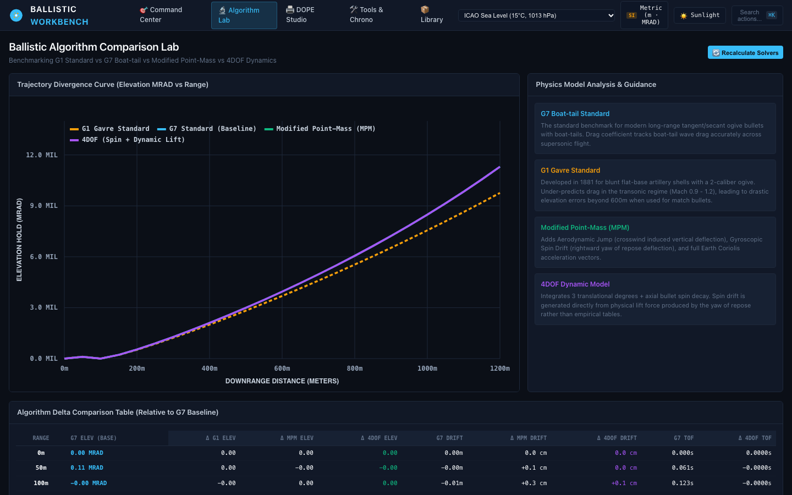
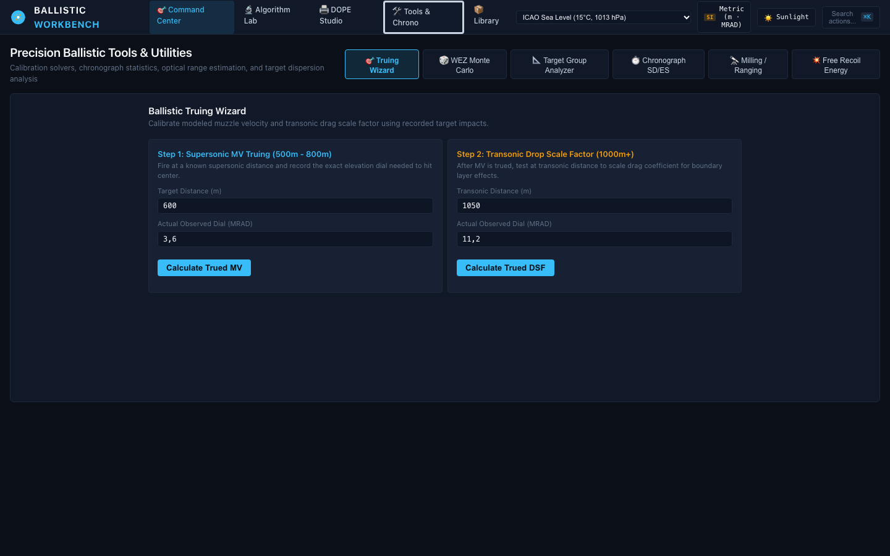
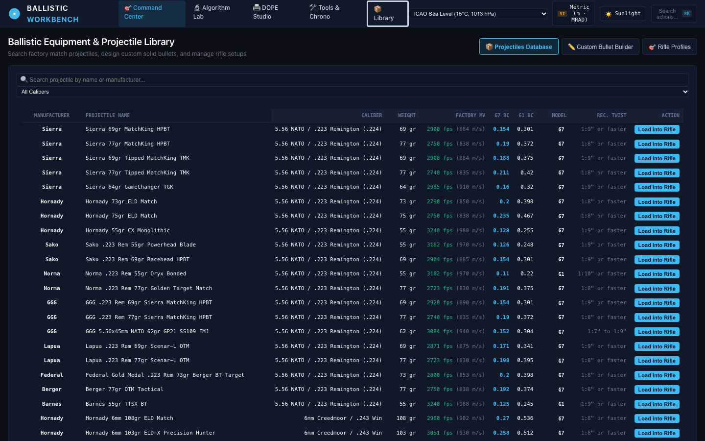
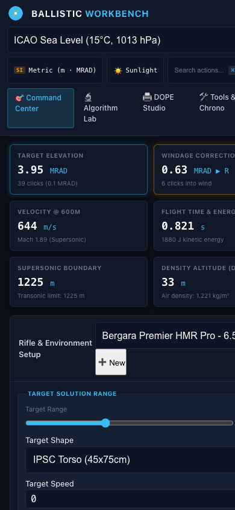

# Ballistic Workbench

An offline-first external ballistics workbench for precision rifle shooters. It solves
trajectories with an RK4 integrator (G1, G7, Modified Point-Mass and 4DOF models), simulates
reticle holdovers and turret dials, trues the model against real impacts, and prints DOPE cards
in field formats: scope cap, wrist coach, stock tape, turret tape, PRS stage card and an A4 data
sheet.

It's for long-range and PRS/NRL shooters, hunters and reloaders who want to plan and check
firing solutions on a laptop or phone, with or without a network on the range.

**Version:** 0.1.0

> Ballistic Workbench is a planning and learning tool. Always confirm firing solutions with live
> fire on a safe range before relying on them.

## What's new

### 0.1.0

- First tracked version: the existing app brought under version control and the app standards.
- Version number shown in the app footer, read from `manifest.json`.
- README, CHANGELOG, CLAUDE.md, SECURITY.md and an MIT license.

Older versions: see [CHANGELOG.md](CHANGELOG.md).

## Screenshots

<table>
  <tr>
    <td><br>Command Center: telemetry, reticle and turret, trajectory chart and DOPE table</td>
    <td><br>Algorithm Lab: G1, G7, MPM and 4DOF solutions side by side</td>
  </tr>
  <tr>
    <td><br>DOPE Studio: print-ready range cards</td>
    <td><br>Tools &amp; Chrono: truing wizard, WEZ, group analysis and more</td>
  </tr>
  <tr>
    <td><br>Library: 177 projectiles, custom bullets and rifle profiles</td>
    <td><br>Phone width (390 px)</td>
  </tr>
</table>

## Features

| View | What it does |
| --- | --- |
| 🎯 **Command Center** | Live firing solution for the active rifle and environment: elevation, windage, velocity, time of flight, energy, supersonic limit and density altitude. Includes a reticle holdover simulator (FFP/SFP, several reticles), an interactive elevation turret, a trajectory chart (drop, velocity, wind drift, time of flight, energy), a wind clock and a configurable DOPE table with CSV export. |
| 🔬 **Algorithm Lab** | Compares G1, G7, Modified Point-Mass and 4DOF solutions on one chart, with a delta table relative to G7. |
| 🖨️ **DOPE Studio** | Print-ready cards: scope cap (SVG), wrist coach, stock tape, turret tape, PRS stage card (with a stage builder, exportable as PNG) and an A4 master data sheet. |
| 🛠️ **Tools & Chrono** | Truing wizard (supersonic muzzle velocity and transonic drop scale factor), WEZ Monte Carlo hit probability, target group analyzer (from a photo or grid), chronograph SD/ES statistics, milling and range estimation, free recoil energy. |
| 📦 **Library** | 177 factory projectiles with search and filters, a custom bullet builder with a live Miller stability estimate, rifle and optic profiles, and JSON backup and restore. |

A command palette (**⌘K** / **Ctrl+K**) reaches every view and most settings.

## Installation

There is no build step and no dependencies. The app is plain HTML, CSS and ES modules, served as
static files.

```sh
git clone https://github.com/jozeta/Ballistic-Workbench.git
cd Ballistic-Workbench
python3 -m http.server 8080
```

Then open <http://localhost:8080>. The app has to be served over HTTP: ES modules and the service
worker don't load from `file://`.

**Install as an app (PWA):** in Chrome or Edge, use *Install app* in the address bar. On iOS
Safari, use *Share → Add to Home Screen*. After the first visit the app works fully offline.

## Configuration

All settings are stored in the browser (`localStorage`) and nothing leaves your device.

| Setting | Where | Options | Default |
| --- | --- | --- | --- |
| Units | Header button / palette | Metric (m, m/s, MRAD, cm) or Imperial (yd, fps, MOA, in) | Metric |
| Theme | Header button / palette | Dark (night) or high-contrast light (sunlight) | Dark |
| Environment | Header dropdown | ICAO sea level, Alpine high (1,950 m), Desert heat (38 °C), Sub-zero winter (-12 °C), or custom values in the Command Center | ICAO sea level |
| Rifle profile | Command Center / Library / palette | Bergara 6.5 Creedmoor, AI AXSR .300 PRC, Tikka T3x .308, Remington 700 .223, or your own | Bergara 6.5 Creedmoor |
| Solver algorithm | Command Center / palette | G1, G7, MPM, 4DOF | G7 |
| Table step | DOPE table | Range step between rows | 25 m |
| Max range | Solver config | Furthest range solved | 1,200 m |
| Spin drift, Coriolis, aerodynamic jump | Solver config | On / off | All on |
| Target | Command Center | Distance, shape (IPSC, circle, square, NATO E), size, speed and direction | 600 m IPSC torso (45 × 75 cm), stationary |

## How to

- **Get a firing solution:** pick a rifle profile, set the environment (or a preset), drag the
  target range. The telemetry bar and the turret show the dial; the reticle shows the holdover.
- **Add your own rifle:** Command Center → **+ New**, or Library → Saved Rifle & Optic Systems.
  Enter muzzle velocity, sight height, zero, twist and the optic, then save.
- **Add a custom bullet:** Library → Custom Projectile Builder. The Miller stability estimate
  updates as you type; aim for Sg ≥ 1.5.
- **True your model:** Tools & Chrono → Truing Wizard. Enter the dial that actually hit at a
  supersonic distance (500 to 800 m) to true muzzle velocity, then a transonic distance (1000 m+)
  to scale drag.
- **Print a DOPE card:** DOPE Studio → pick a format → its **Print** button (the print stylesheet strips the
  UI), or **Download SVG** / **Save PNG** where offered.
- **Back up or move your data:** Library → **Export Library (JSON)**; restore with **Import JSON** on any device.
- **Export the DOPE table:** Command Center → DOPE table → **CSV**.

## Tests

```sh
node tests/verify.mjs          # physics, solvers, units, truing and WEZ
node tests/version.mjs         # version agrees across manifest, service worker, README and CHANGELOG
node tests/browser_check.mjs   # headless Chrome: every view, interactions, zero console errors
```

`browser_check.mjs` needs Google Chrome installed in `/Applications`.

## License

MIT. See [LICENSE](LICENSE).
