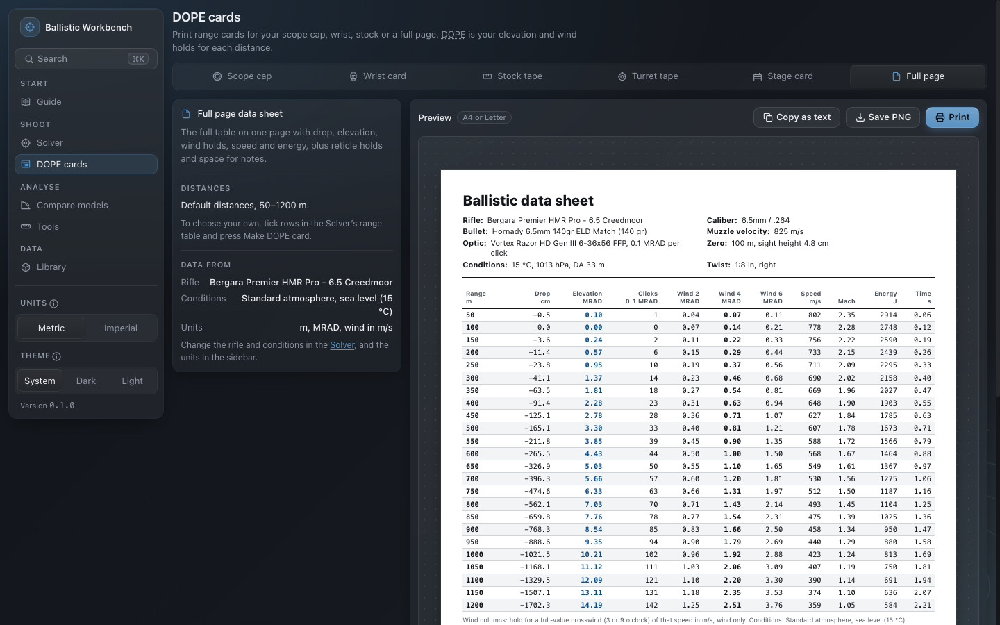
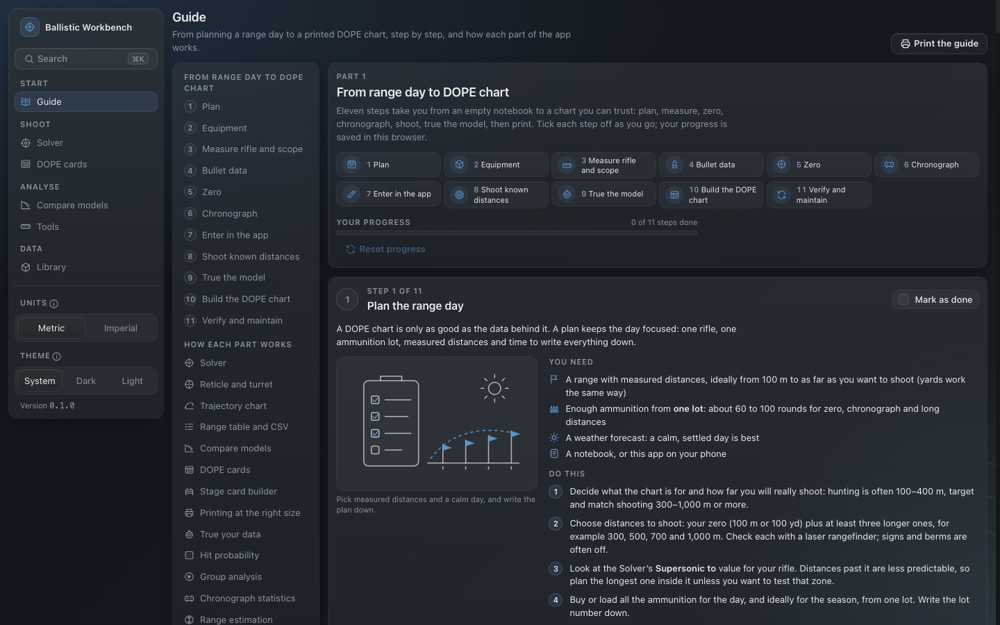
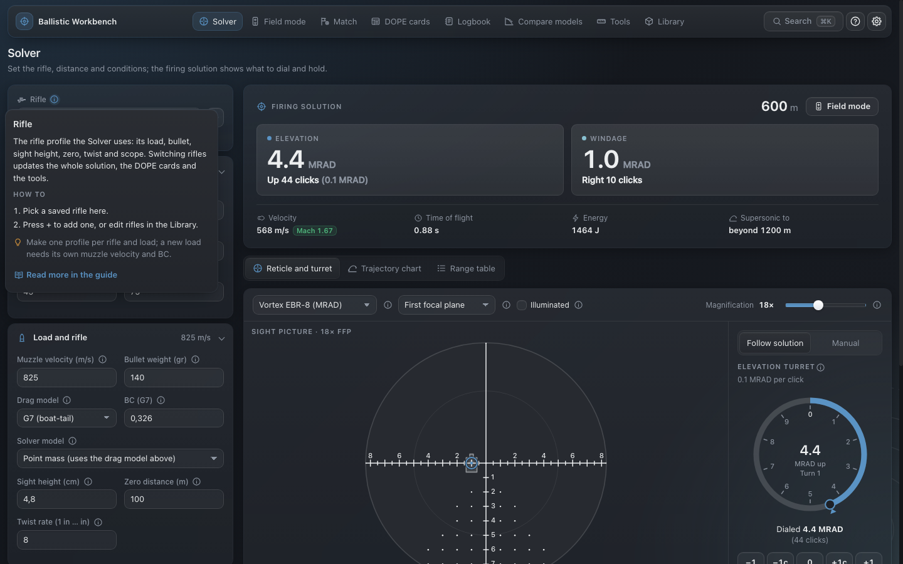
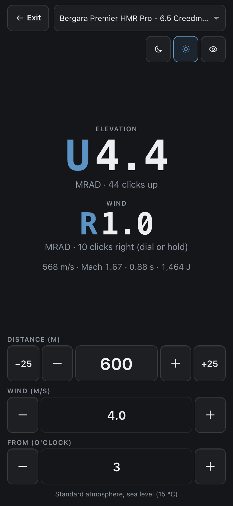
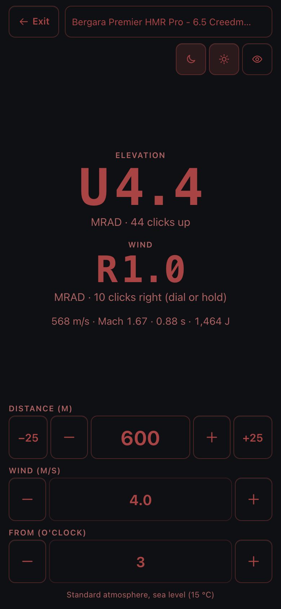
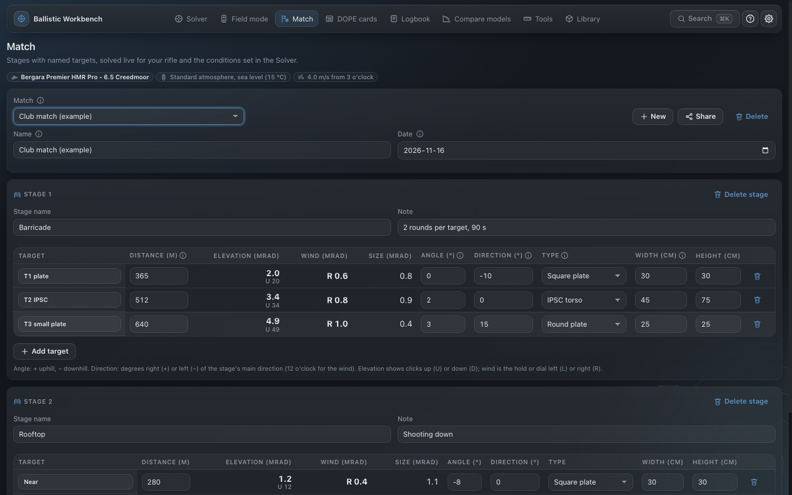
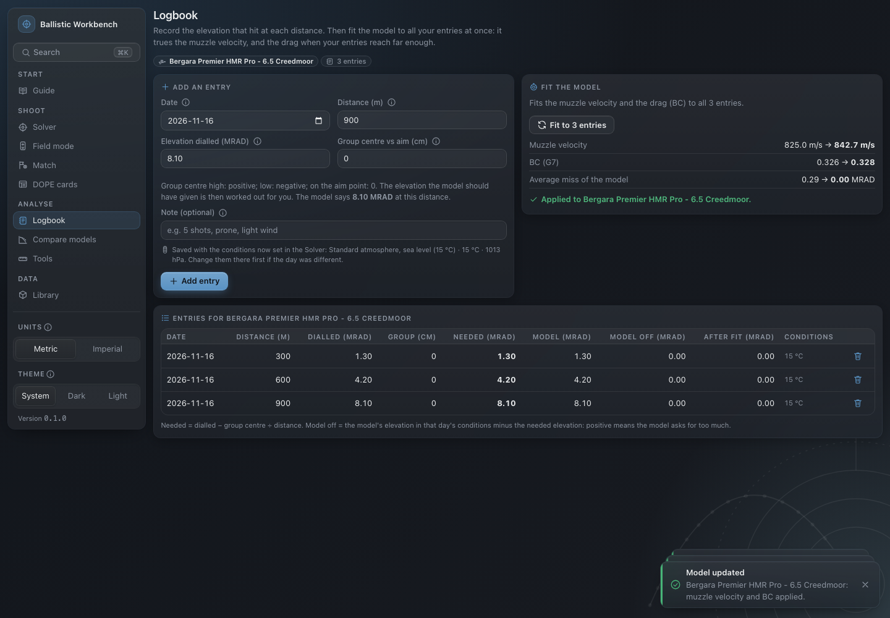
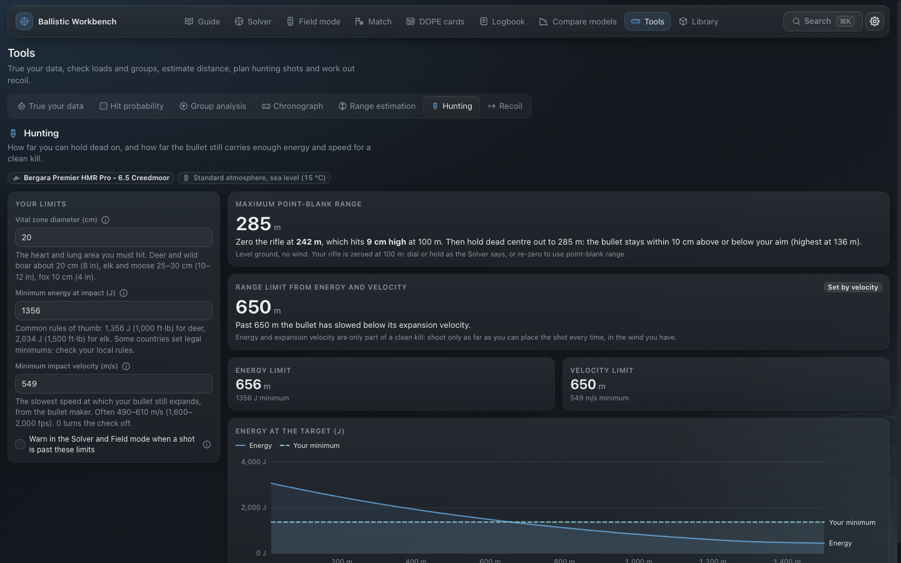
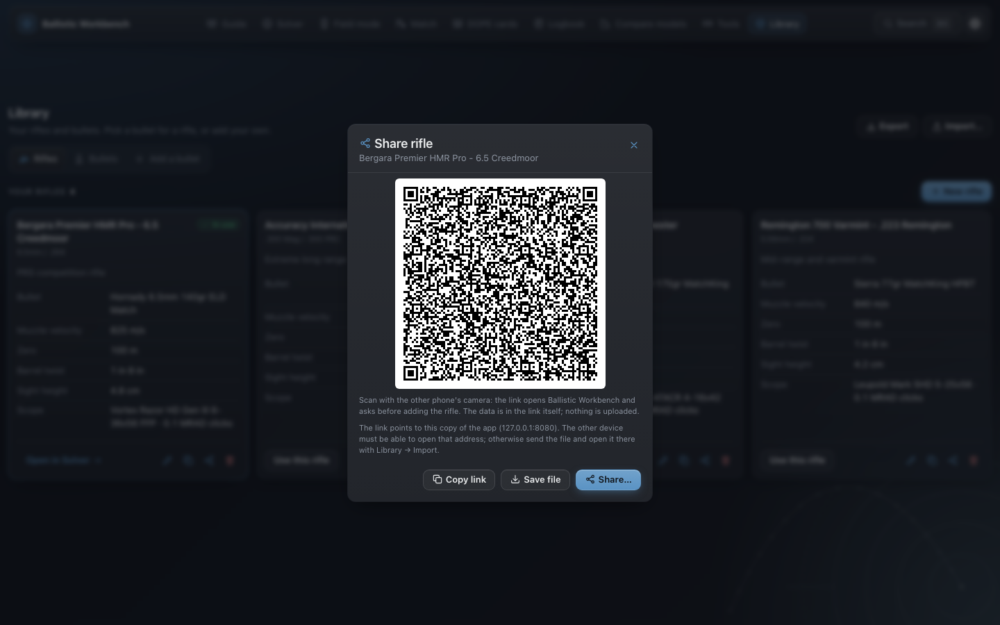

# Ballistic Workbench

An offline ballistics calculator for precision rifle shooters. Pick your rifle, set the distance
and conditions, and it tells you what to dial: elevation and windage in MRAD or MOA, with the
clicks for your scope. It also shows the hold in a simulated reticle, plots the trajectory, prints
range cards (DOPE cards) and has tools to true the model against your real impacts.

It's for long-range and PRS/NRL shooters, hunters and reloaders who want to plan and check firing
solutions on a laptop or phone, with or without a network on the range. Everything runs in the
browser; nothing is sent anywhere.

**Version:** 0.1.0

**Use it online:** <https://jozeta.github.io/Ballistic-Workbench/>. Nothing to install; after the
first visit it also works offline, and you can add it to your home screen.

> Ballistic Workbench is a planning and learning tool. Always confirm firing solutions with live
> fire on a safe range before relying on them.

## What's new

### 0.1.0

The first version, with a complete redesign and a corrected ballistics engine:

- **Correct drag model.** Standard G1 and G7 drag tables (JBM), cross-checked against an independent
  solver within 0.01 MRAD and against Hornady's published 6.5 Creedmoor table. Corrected aerodynamic
  jump, spin drift, cant, Coriolis, stability and powder temperature; the zero no longer shifts with
  field conditions; 27 bullet BCs corrected to published values.
- **New interface** in the Låda Glass design: a menu bar at the top, Låda components and charts, dark
  and light themes (follows your system), Units and Theme in **Settings** (the cogwheel), custom icons and line art, plain-language text, and layouts
  for phones, tablets and computers.
- **Guide:** a step-by-step, illustrated walkthrough from planning a range day to a printed DOPE
  chart (measuring sight height, twist and click value, zeroing, chronograph, shooting known
  distances, truing), plus how every part of the app works. Progress is saved.
- **Help everywhere:** an **i** next to every setting explains what it is, how to measure or choose
  it and typical values, with a link to the guide.
- **Solver** shows one clear firing solution (elevation and windage with direction and clicks),
  solved exactly at your distance, with the reticle, trajectory chart and range table in tabs. The
  turret follows the solution by default. Angles follow your scope (MRAD or MOA) whatever the
  distance units. Inputs are validated as you type.
- **DOPE cards** print at exact physical size; **Tools** each give a plain verdict; **Library**
  can edit, duplicate and delete rifles with undo.
- **Field mode:** the answer in big type with large steppers, a red night mode and the screen kept on.
- **Match:** stages with named targets at their own distance, angle and direction, solved live.
- **Logbook:** record impacts at many distances and fit muzzle velocity and BC to all of them at once.
- **Hunting:** maximum point-blank range and the range limit from minimum energy and velocity.
- **Sharing:** pass a rifle or a match to another phone by QR code, link or file, without uploads.
- **Security:** strict Content-Security-Policy, imported and saved data is validated, no inline
  code, offline cache limited to the app's own files.

See [CHANGELOG.md](CHANGELOG.md) for the full list.

## Screenshots

<table>
  <tr>
    <td><br>Solver: the firing solution, with the reticle hold and elevation turret</td>
    <td><br>The same in the light theme</td>
  </tr>
  <tr>
    <td><br>DOPE cards: six printable formats with a true-size preview</td>
    <td><br>Tools: true your data, hit probability, group analysis, chronograph, range estimation, recoil</td>
  </tr>
  <tr>
    <td><br>Library: your rifles, 177 bullets and your own bullets</td>
    <td><br>Compare models: how G1, G7 and modified point mass differ, explained in plain words</td>
  </tr>
  <tr>
    <td><br>Guide: from range day to DOPE chart, step by step</td>
    <td><br>An i next to every setting explains it and links to the guide</td>
  </tr>
  <tr>
    <td> <br>Field mode: big readout and steppers; night mode in dim red</td>
    <td><br>Match: stages with named targets, each solved for the day's conditions</td>
  </tr>
  <tr>
    <td><br>Logbook: impacts at many distances, fitted all at once</td>
    <td><br>Tools → Hunting: point-blank range and the energy and velocity limits</td>
  </tr>
  <tr>
    <td><br>Share a rifle or match by QR code, link or file</td>
    <td></td>
  </tr>
  <tr>
    <td><br>Phone layout (390 px)</td>
    <td><br>Full-page data sheet in the light theme</td>
  </tr>
</table>

## Features

| View | What it does |
| --- | --- |
| **Guide** | Step by step from planning a range day to a printed DOPE chart: plan, equipment, measure rifle and scope (sight height, twist, click value, cant), bullet data, zero, chronograph, enter in the app, shoot known distances, true the model, build the chart, verify and maintain. Each step has an illustration, what you need, numbered instructions, tips and buttons into the app. Part 2 explains every view and tool; a glossary explains the terms. |
| **Field mode** | For the firing line: the elevation and wind (with clicks and direction) fill the screen; big − / + steppers for distance (5 and 25), wind speed and the clock direction it comes from, held to repeat. Night turns everything dim red; Screen on keeps the phone awake; Full screen where the browser allows it. Changes are shared with the Solver. |
| **Solver** | The firing solution for the active rifle at the exact target distance: elevation and windage (MRAD or MOA, direction and clicks), velocity with Mach, time of flight, energy and how far the bullet stays supersonic. Tabs: a reticle view showing where to hold, with an elevation turret you can dial (mouse, touch or keyboard); a trajectory chart (drop, velocity, wind drift, time of flight, energy); a range table with CSV export, where you tick the distances for your DOPE card. |
| **Match** | Matches with stages (name, note) and targets in shooting order: distance, shot angle (+ uphill), direction in degrees right or left of the stage's main direction, type and size. Every target shows the elevation with clicks, the wind hold and its size in your reticle unit, for the active rifle and the Solver's conditions. Share a match as a QR code, link or file. |
| **Logbook** | Entries per rifle: date, distance, elevation dialled, where the group centre landed (+ high, − low), a note, and the conditions of that day. The table shows the elevation that would have hit and how far the model is off. **Fit** finds the muzzle velocity, and the BC when the entries reach 500 m (550 yd) and spread 1.5×, that match all entries at once, with the average miss before and after; **Apply** saves it to the rifle. |
| **Compare models** | How the point-mass G1 and G7 solutions and modified point mass (MPM: adds spin drift, aerodynamic jump and Coriolis) differ for your rifle, as difference charts and a table, with a plain explanation of why. "Use in Solver" switches the model. |
| **DOPE cards** | Printable range cards at exact physical size: scope cap insert, 3 × 5 in wrist card, stock tape, turret tape, match stage card (with a stage builder and wind holds for lull, base and gust) and a full-page data sheet. Copy as text, save as image, or print. |
| **Tools** | **True your data** (muzzle velocity from a 500–800 m impact, then drag from a 1,000 m+ impact, applied to the rifle), **Hit probability** (simulates 500–2,000 shots from your error sources and shows what causes misses), **Group analysis** (from a photo or clicks: extreme spread, mean radius, dispersion ellipse and the correction to centre the group), **Chronograph** (SD, ES, mean; use the mean as muzzle velocity), **Range estimation** (from target size and reticle reading), **Hunting** (maximum point-blank range for a vital zone, the zero to set for it, and the range limit from your minimum energy and impact velocity, with an energy chart), **Recoil** (free recoil energy and velocity). |
| **Library** | Your rifles (use, edit, duplicate, delete with undo), 177 factory bullets with search and caliber filter (published BCs marked with their source, derived ones marked "estimated"), your own bullets with a live Miller stability check, and backup to / restore from a file. Share a rifle as a QR code, link or file. |

The command palette (**⌘K** on Mac, **Ctrl+K** elsewhere, or **Search** in the menu bar) reaches every view, tool and setting. Every setting has an **i** with an explanation.

## Installation

The easiest way is the hosted app: open <https://jozeta.github.io/Ballistic-Workbench/> (GitHub
Pages, published from `main`). Your data stays in your browser either way.

To run your own copy: there is no build step and the app has no runtime dependencies (plain HTML,
CSS and JavaScript modules served as static files).

```sh
git clone https://github.com/jozeta/Ballistic-Workbench.git
cd Ballistic-Workbench
npm start            # or: node scripts/serve.mjs [port]
```

Then open <http://localhost:8080>. You need Node.js 18 or later; the server has no dependencies, so
`npm install` isn't needed to run the app. The app must be served over HTTP (JavaScript modules and
the offline service worker don't load from `file://`). Don't use `python3 -m http.server`: it drops
connections when the browser loads the app's modules in parallel, and the app then fails to start.

**Install as an app:** open the hosted app (or your own copy), then in Chrome or Edge use *Install
app* in the address bar; on iPhone or iPad,
Safari's *Share → Add to Home Screen*. After the first visit the app works fully offline.

## Configuration

Settings are stored in your browser (`localStorage`); nothing leaves your device. Use
**Library → Export…** to keep a backup.

| Setting | Where | Options | Default |
| --- | --- | --- | --- |
| Units | Settings (cogwheel), palette | Metric (m, m/s, cm) or imperial (yd, fps, in). Angles (MRAD or MOA) and clicks follow the active rifle's scope, so a mil scope shows MRAD with yards too | Metric |
| Theme | Settings (cogwheel), palette | System, dark, light | System |
| Rifle | Solver, Library, palette | Four example rifles (6.5 Creedmoor, .300 PRC, .308 Win, .223 Rem) or your own | 6.5 Creedmoor |
| Distance and target | Solver → Target | Distance; target IPSC torso (45 × 75 cm), NATO E-type (50 × 100 cm), round plate (30 cm) or square plate (30 × 30 cm); width and height editable | 600 m, IPSC torso |
| Load and rifle | Solver → Load and rifle | Muzzle velocity, bullet weight, drag model (G1/G7, sets the drag table), BC, solver model, sight height, zero distance, twist | From the rifle |
| Solver model | Solver → Load and rifle, Compare models, palette | Point mass (with the bullet's drag model) or modified point mass (adds spin drift, aerodynamic jump and Coriolis) | Point mass |
| Atmosphere | Solver → Atmosphere | Presets (sea level, mountains 1,950 m, desert heat, winter) or your own temperature, station pressure, altitude (moves the pressure with the standard atmosphere) and humidity; editing a preset creates Custom conditions; density altitude is shown | Standard atmosphere, sea level |
| Wind | Solver → Wind | Speed and the direction it comes from (drag the wind clock or type degrees; 90° = from the right) | 4 m/s from 3 o'clock |
| Shot angle and cant | Solver → Shot angle and cant | Inclination (+ uphill) and rifle cant (+ right) | 0° and 0° |
| Scope | Solver → Reticle tab, rifle dialog | Reticle, first or second focal plane, magnification, click value (0.1 / 0.05 MRAD, 1/4 / 1/8 MOA) | From the rifle |
| Turret | Solver → Reticle and turret | Follow solution (the turret is set to the answer, the reticle shows the wind hold) or Manual (you dial; the reticle shows the remaining hold) | Follow solution |
| Range table | Solver → Range table | Row spacing 10 / 25 / 50 / 100 m or yd (imperial rows land on round yards); visible columns; ranges ticked for DOPE cards (remembered) | 25, all columns, every 100 ticked |
| DOPE card | DOPE cards | Format, distances (defaults or the ones ticked in the Solver), card size and colour | Full page |
| Field mode | Field mode | Night (dim red), Screen on (wake lock); remembered | Night off, Screen on |
| Matches | Match | Name, date; stages with name and note; targets with distance, angle (−60 to +60°), direction (−90 to +90°), type, width and height | None (an example on request) |
| Logbook | Logbook | Entries per rifle (up to 500 in all): date, distance, elevation dialled, group centre vs aim, note; the conditions are copied from the Solver when you add an entry | None |
| Hunting | Tools → Hunting | Vital zone diameter, minimum energy, minimum impact velocity (0 turns it off), warn in the Solver and Field mode | 20 cm, 1,356 J (1,000 ft·lb), 549 m/s (1,800 fps), off |
| Guide progress | Guide | Steps marked as done | None |

## How to

- **New here?** Open the **Guide** (the ? next to the cogwheel, top right): it walks you from planning a range day to a
  printed DOPE chart, and every setting has an **i** that explains it.
- **Get a firing solution:** choose your rifle at the top of the Solver, set the distance under
  **Target**, then check **Atmosphere** and **Wind**. The firing solution card shows what to dial.
- **Add your rifle:** press **+** next to the rifle in the Solver, or **Library → New rifle**. Pick a
  bullet from the list (or enter your own), then the muzzle velocity, zero, sight height and scope.
- **True the model to your rifle:** **Tools → True your data.** Shoot at 500–800 m, enter the
  elevation that centred your group and apply the muzzle velocity. Then do the same at 1,000 m or
  more to true the drag (it adjusts the BC).
- **Use your chronograph:** **Tools → Chronograph**, paste the velocities (spaces, commas or new lines
  between readings; 825,4 and 825.4 both work) and use the mean as the rifle's muzzle velocity.
- **Print a DOPE card:** in the Solver's **Range table**, tick the distances you want and press
  **Make DOPE card** (or go to **DOPE cards** directly for sensible defaults). Pick a format and press
  **Print card**. Check the 50 mm scale bar with a ruler: printers sometimes scale pages.
- **Plan a match stage:** **DOPE cards → Stage card**, choose a preset or add targets, set the lull,
  base and gust wind; the card shows the elevation and wind hold for every target.
- **Use it on the firing line:** press **Field mode** on the Solver's firing solution (or in the
  menu). Step the distance and wind with the big buttons; tap **Night** after dark. On a phone,
  add the app to the home screen for a true full-screen view.
- **Plan a match:** **Match → New** (or **Start from an example**), add stages and targets with their
  distance, angle and direction. On the day, set the atmosphere and wind in the Solver or Field mode
  and every target updates.
- **True the model with many distances:** set the day's atmosphere in the Solver, then in **Logbook**
  add each distance with the elevation you dialled and where the group landed. Press **Fit**, check
  the average miss, and **Apply**.
- **Check a hunting load:** **Tools → Hunting**, enter the vital zone and your minimum energy and
  velocity. It tells you the point-blank range, the zero to set for it, and how far the load is
  good for.
- **Share a rifle or match:** the share button on a rifle in the Library, or **Share** in Match. Let
  the other phone scan the QR code, or send the link or the file. The receiver is asked before
  anything is added.
- **Back up or move your data:** **Library → Export…** saves a file; **Import…** restores it on any
  device (files are checked before anything is replaced).

## Tests

```sh
npm install          # dev tools only (ESLint); the app itself needs nothing
npm test             # physics and reference checks, features (hunting, logbook fit, sharing), helpers, version, offline cache list
npm run test:browser # headless Chrome: every view in both themes and at phone width
npm run lint
```

`test:browser` needs Google Chrome (set `CHROME_PATH` if it isn't in `/Applications`). CI runs all of
these on every push.

## Design

The interface uses Låda Glass 2.2.1 (`vendor/lada-glass/2.2.1/`). QR codes are drawn with
[qrcode-generator](https://github.com/kazuhikoarase/qrcode-generator) 2.0.4 by Kazuhiko Arase (MIT,
`vendor/qrcode-generator/2.0.4/`). The icons (`assets/icons.svg`) and
line-art graphics (`assets/art.svg`) are drawn for this app in the same style.

## License

MIT. See [LICENSE](LICENSE).
